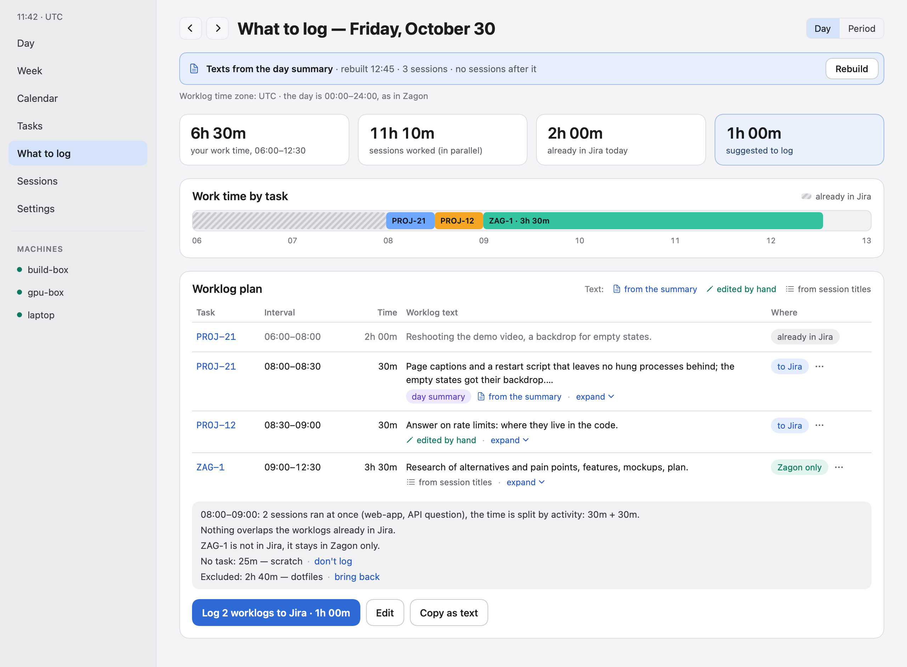
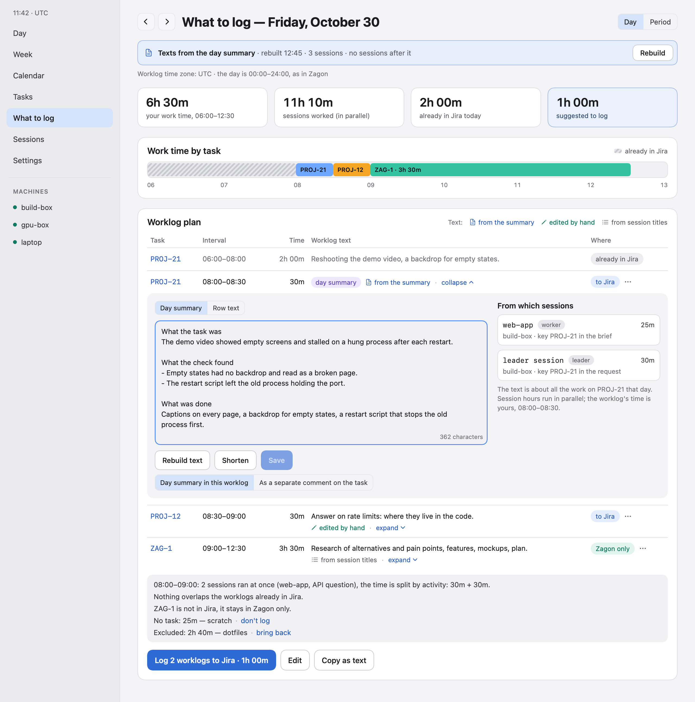
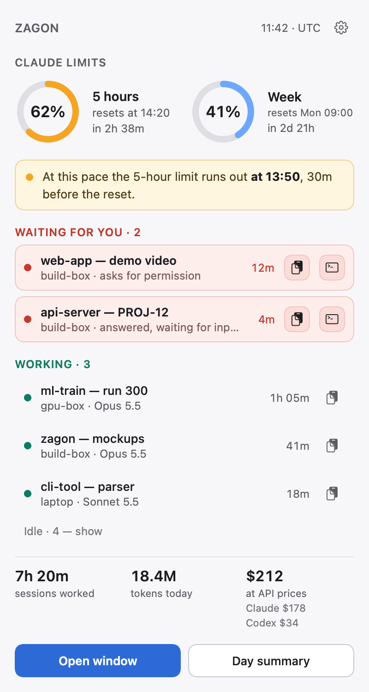
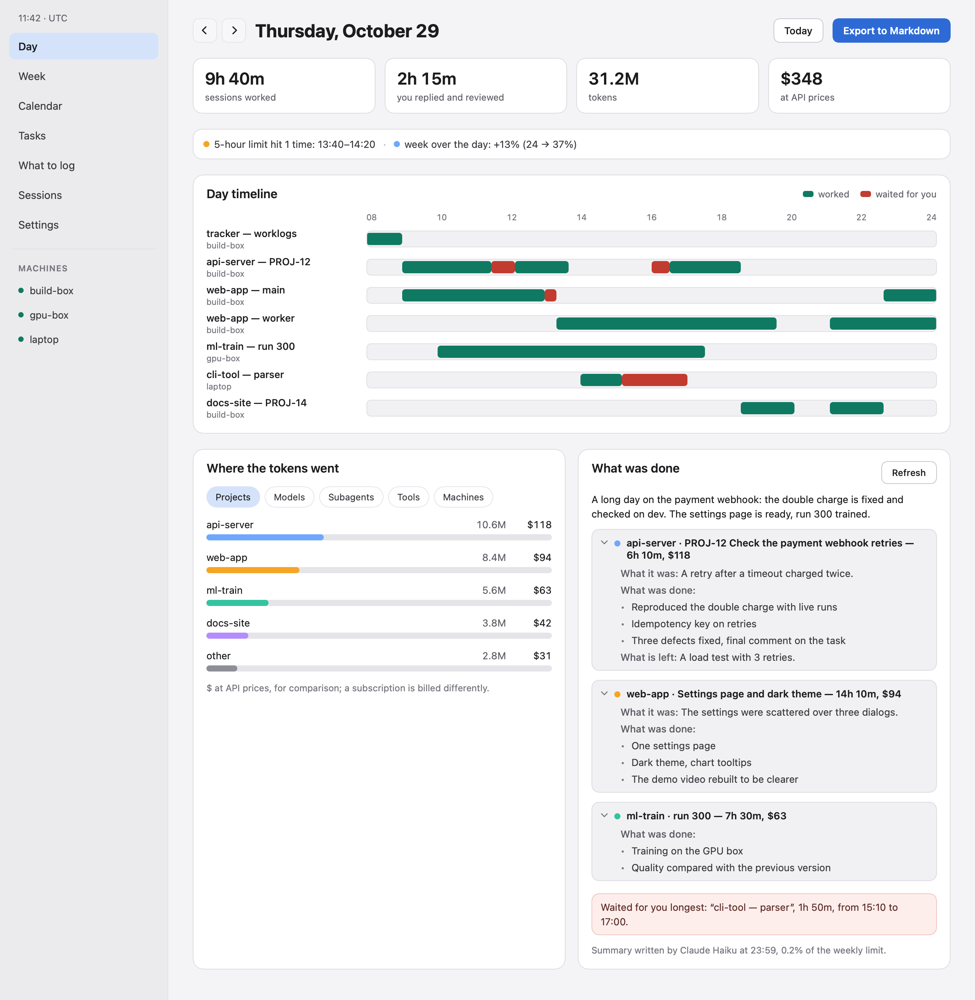
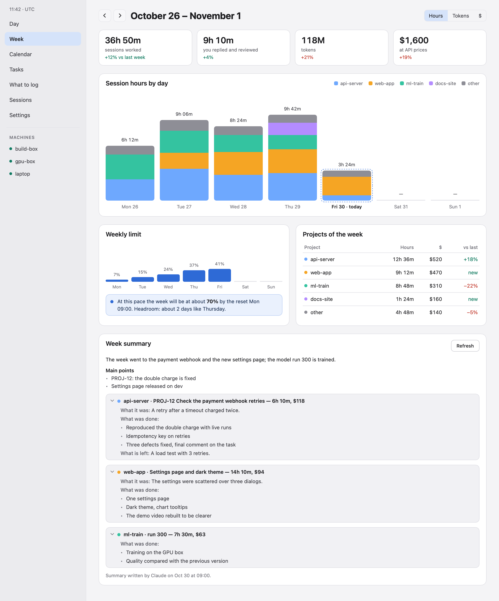
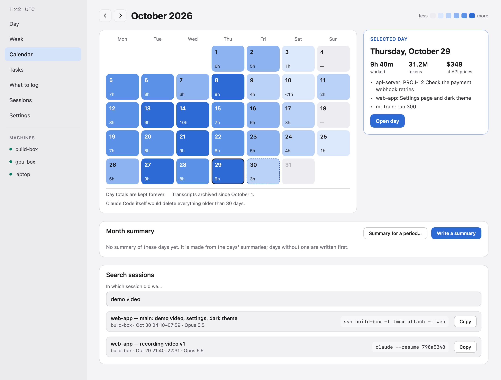

# Zagon

**Jira worklogs from your Claude Code and Codex CLI sessions: on a Linux server, over MCP, or in the macOS menu bar.**

[](https://github.com/a1lezakty/zagon/releases/latest)
[](LICENSE)


Zagon reads the session files Claude Code and Codex already write (and what Cursor's agent reports through the same
hooks) and turns them into time per task: a Jira key (`PROJ-123`) in the git branch, the session title, a message you
typed or a commit links that work to the task. It plans the day's worklogs with a short text for each, reconciles a
period with what is already in Jira, and writes to Jira only after you confirm. Around that: subscription limits,
which sessions are waiting for you, tokens and $ per day and project, a daily "what was done" summary, alerts in
Telegram or ntfy, context handoff between sessions, and an MCP server, so Claude or Codex can answer from the same
data. The data stays on your machine: only the AI calls on your own subscription, Jira and notifications when you
set them up, and update checks use the network ([Privacy](#privacy)).

<picture>
  <source media="(prefers-color-scheme: dark)" srcset="docs/images/worklog.png">
  
</picture>

## Install

Linux server (x86_64 or aarch64), a single static binary:

```sh
curl -fsSL https://raw.githubusercontent.com/a1lezakty/zagon/main/install.sh | sh -s -- --enable-service
zagon doctor
zagon setup jira      # optional: connect Jira Cloud by answering a few questions
zagon notify setup    # optional: alerts through your own Telegram bot or an ntfy topic
```

macOS 13 or later: [Zagon.dmg](https://github.com/a1lezakty/zagon/releases/latest/download/Zagon.dmg), then
**Connect Claude Code / Codex** in its window. The app is not notarized, so its first launch needs System Settings →
Privacy & Security → **Open Anyway** ([steps](#macos-app)).

Homebrew (macOS and Linux), from the tap [a1lezakty/homebrew-zagon](https://github.com/a1lezakty/homebrew-zagon):

```sh
brew install --cask a1lezakty/zagon/zagon     # Zagon.app
brew install a1lezakty/zagon/zagon            # the CLI alone; then: zagon install --bin "$(brew --prefix)/opt/zagon/bin/zagon"
```

Homebrew installs keep up with `brew upgrade` (the app also updates itself), not `zagon update`.

The hooks and the MCP tools reach sessions started after the install: restart the Claude Code and Codex sessions you
have open. What install changes and how to undo it: [Install on a Linux server](#install-on-a-linux-server).

**Try it without installing.** The binary reads the transcripts by itself; it writes only to `~/.zagon` and changes
no settings:

```sh
curl -fsSLO https://github.com/a1lezakty/zagon/releases/latest/download/zagon-linux-x86_64   # or zagon-linux-aarch64
chmod +x zagon-linux-x86_64 && ./zagon-linux-x86_64 week
```

On a Mac the same works with `zagon-macos-universal`. Every release file has a checksum and a signed build
provenance: [how to verify a download](SECURITY.md#verify-a-download).

Without `install` you get tokens, time, projects and tasks, but no live status (working / waiting for you), no Claude
limits and no service: those come from the hooks and the status line.

## Ask Claude or Codex

With the MCP server registered (`zagon install` does it), ask in any session:

- "Where do I stand?" (`status`: limits, sessions waiting for you, what is left to log today)
- "What did I work on yesterday, and what should go to Jira?" (`worklog_plan`)
- "Set the text of the PROJ-12 row to 'Retries made idempotent' and don't log the scratch row." (`worklog_text`,
  `worklog_skip`, each after you confirm)
- "Log yesterday to Jira." (`worklog_commit`, only on your explicit request)
- "Do my Jira worklogs for October match my sessions?" (`worklog_reconcile`)
- "What did I get done this month?" (`summary`)
- "How much of my 5-hour and weekly limits is left?" (`limits`)
- "Which sessions are waiting for me?" (`sessions`)
- "Compare this week with the last one." (`week`)
- "Find the session where I fixed the login redirect." (`search`)
- "Write a handoff of this session, I'll continue in Codex." (`handoff_create`)

All tools: [MCP](#mcp).

## How it differs

| If you want | Use |
|---|---|
| Limits in the menu bar for many AI providers (Cursor, Gemini, Copilot and others) | [CodexBar](https://github.com/steipete/CodexBar): 80+ providers, a notarized app, Homebrew |
| Tokens and $ in the terminal for many CLI agents, nothing to install | [ccusage](https://github.com/ccusage/ccusage) |
| The current limits and cost inside a session | built in: Claude Code `/usage`, Codex `/status` |
| Time per Jira task from your sessions, worklogs with texts, a period reconciled with Jira | Zagon |
| A headless Linux server or tmux box: a service with alerts, MCP answers about limits, days and sessions | Zagon |
| History after Claude Code's 30-day cleanup, Claude Code, Codex and Cursor's agent in one place, a Mac that reads your servers over SSH | Zagon |

Zagon shows no limits or $ for Cursor's agent (only its sessions, time and tokens), does not count other providers
or the other editors' own agents, has no GUI on Linux or Windows, and its Mac app is not notarized.

## Privacy

- **Local, no telemetry.** Data stays in `~/.zagon`. The network is used for the AI calls below (through your own
  `claude` or `codex`), a notification channel (Telegram or ntfy) and Jira when you set them up, and updates from
  GitHub (`zagon update` when you run it; the Mac app checks once a day unless you turn that off).
- **Files, not accounts.** Zagon reads the transcripts in `~/.claude/projects`, Codex's session files and, for
  Cursor's agent, its hooks, earlier chats and its list of conversations in Cursor's `state.vscdb` (ids, folders,
  times and titles only). Limits come from what Claude Code passes to its status line and from Codex's own files: it
  never reads OAuth tokens, cookies or credential files and calls no usage API.
- **Numbers, not conversations.** The database keeps numbers, times, projects, branches and session titles (for an
  old Cursor chat, the first line you typed in it). Text goes
  only into the local archive of transcripts and into short digests for three AI calls (the day summary, the worklog
  texts, the evening task suggestions), run on your own `claude` or `codex` subscription.

All the details: [Privacy in detail](#privacy-in-detail).

### Under an NDA

What to turn off when your employer limits where code and conversations go:

- **Archive.** The service keeps compressed copies of transcripts in `~/.zagon/archive`, also after Claude Code's own
  cleanup. When your organization sets `cleanupPeriodDays` in Claude Code's managed settings, the archive keeps Claude
  Code transcripts no longer than that (0: none) and removes older copies; `zagon doctor` says which rule applies.
  Codex copies are not bound by it. To keep no copies at all, run the service with `zagon daemon --no-archive`:
  `systemctl --user edit zagon` (a system unit: `sudo systemctl edit zagon-<user>`), add `[Service]`, `ExecStart=`
  and `ExecStart=<path to zagon> daemon --no-archive`, then restart the service. Delete `~/.zagon/archive` if it was
  written.
- **AI calls.** The day summary, the worklog texts (the service at 23:55, on a Mac without a server the app at 23:55,
  `zagon log plan --refresh`, MCP `worklog_refresh`, the Mac app's Rebuild) and the evening task suggestions send
  titles, project and branch names, edited file names, commit subjects
  and words of your typed messages (secrets redacted) to your Claude or Codex subscription. `[summary] engine = "none"`
  turns all of them off (summaries and texts are then built without AI); `[tasks] evening_suggestions = false` stops
  only the evening call. Restart the service after changing either.
- **Notifications.** Telegram and ntfy messages carry session titles, project names and the day summary. Leave them
  off, or point `[ntfy] url` at your own ntfy server.
- **Cursor.** Zagon reads Cursor's old chats and its list of conversations whenever they exist; there is no switch
  for that in Zagon. A chat read from an old transcript is titled by the first line you typed there, and that title
  goes where titles go (the database, notifications, AI digests). Turning off Third-Party Imports in Cursor
  (Settings → Agents) stops only its hooks: Cursor 3's list of conversations (ids, folders, times and titles) is
  still read.
- **Search.** Every command that scans indexes your typed words for search (the words, not the text). To keep them
  out, pass `--no-index-prompts` everywhere a scan runs: the service (`zagon daemon`, as for the archive), `zagon scan`
  and the MCP server (`claude mcp add --scope user zagon -- zagon mcp --no-index-prompts`, the same for `codex mcp
  add`); reports take it too. The Mac app always indexes.

### Checked with

Claude Code 2.1.316 and Codex CLI 0.166.0 on a live server (1 November 2026); the test fixtures come from Claude Code
2.1.233–2.1.250 and Codex 0.78–0.166. `zagon doctor` shows the versions writing your logs next to these. Both change
their files often: if the numbers stop adding up after an update, open an issue with the output of `zagon doctor`.
Cursor's agent is new in 0.1.5: built from Cursor's documentation and the files of Cursor 3.27 on a Mac, not yet run
against a live Cursor for long.

## Screens

The macOS app (sample data; light or dark as your system, or set in Settings → General → Appearance): a worklog row
opened, the menu bar, then the Day, Week and Calendar windows.

<picture>
  <source media="(prefers-color-scheme: dark)" srcset="docs/images/worklog-row.png">
  
</picture>

<p align="center"><picture>
  <source media="(prefers-color-scheme: dark)" srcset="docs/images/main.png">
  
</picture></p>

<picture>
  <source media="(prefers-color-scheme: dark)" srcset="docs/images/day.png">
  
</picture>

<picture>
  <source media="(prefers-color-scheme: dark)" srcset="docs/images/week.png">
  
</picture>

<picture>
  <source media="(prefers-color-scheme: dark)" srcset="docs/images/calendar.png">
  
</picture>

> **Status: early releases (0.x).** Binaries and the macOS app are on the
> [Releases](https://github.com/a1lezakty/zagon/releases) page. Commands in this README are the ones the latest
> release has.

| Feature | State |
|---|---|
| Claude Code transcripts and Codex sessions: tokens, models, tools, projects, sub-agents | works |
| Cursor's agent: sessions, live status, time and the tokens its hooks report (no limits, no $) | new in 0.1.5 |
| Session time and your own time per day, live status from hooks (working / waiting for you) | works |
| CLI reports: `today`, `day`, `week`, `sessions` | works |
| Background service (`zagon daemon`), install / uninstall / doctor, `zagon setup jira`, `zagon notify setup` | works |
| Limits from the Claude Code status line and Codex session files: MCP `limits`, Telegram `/limits`, alerts | works |
| MCP server for Claude Code and Codex (`zagon mcp`): reports and search | works |
| Notifications (Telegram, ntfy) and a Telegram bot | works |
| Daily "what was done" summary (`zagon summary`, sent in the evening) | works |
| Compressed archive of transcripts, kept after Claude Code deletes them (`zagon archive`) | works |
| Context handoff between sessions and tools (`zagon handoff`, MCP `handoff_*`) | works |
| Task list, worklog plan, Jira (`zagon task`, `zagon log`, MCP `task_*`, `worklog_*`), hours for invoices (`zagon log export`) | works |
| macOS app: menu bar, Day / Week / Calendar / Tasks windows, servers over SSH, self-updating | works |
| Release binaries, install script, `zagon update` | works |
| Homebrew tap: the CLI formula (macOS, Linux) and the app's cask | works |

## Privacy in detail

- Everything stays local and there is no telemetry. The only network requests are the notifications you configure
  (Telegram Bot API or ntfy, through `curl`), Jira if you connect it, and updates: `zagon update` goes to GitHub only
  when you run it (the service never checks), and the macOS app checks its update feed on GitHub once a day (turn
  that off in Settings → General → Updates).
- It reads only local files: Claude Code transcripts (`~/.claude/projects`, and `<dir>/projects` of another account's
  `CLAUDE_CONFIG_DIR`), Codex session files and its thread index
  (`~/.codex/sessions`, `~/.codex/archived_sessions`, `~/.codex/state_*.sqlite`), plus what its own hooks and status
  line wrapper record. To name the project of a working directory it also looks for a `.git` above it (and a
  worktree's `commondir`) and reads the `origin` URL from its git config; it stores the directory paths and project
  names, never file contents or URLs.
- Cursor's agent: its hooks (below) count it from when they first fire. For the days before, Zagon reads Cursor's
  earlier chats (`~/.cursor/projects/*/agent-transcripts`, Cursor up to 2.x): the first line of a chat's first
  request (up to 80 characters) becomes its title, and the requests that carry a time stamp are treated like typed
  messages of Claude Code (placed in the day, indexed for search, scanned for task keys). Cursor 3 keeps no
  transcripts: Zagon opens Cursor's own list of conversations in its `state.vscdb` read-only and takes only ids,
  workspace, times and titles, never the chats' text or Cursor's login, plus each workspace's `workspace.json` (its
  folder); that list is copied to `~/.zagon/cursor/headers.ndjson`.
- While a Claude session is active, the service also runs `claude agents --json` (Claude Code 2.1.145 or later) for
  the live statuses hooks may miss: session ids, folders and statuses.
- Limits come only from what Claude Code passes to its status line (`rate_limits`, Claude Code 2.1.80+ on Pro and
  Max) and from Codex's own session files. Zagon never reads or stores OAuth tokens, cookies or credential files,
  and it does not call any usage API. So it shows the 5-hour and weekly windows, and the last reading when no
  session is running. The current reading is the highest one of the newest window, from any session or connected
  server: a session left open keeps re-sending its older, lower reading.
- **Two Claude Code accounts on one machine** (`CLAUDE_CONFIG_DIR=~/.claude-work claude …` next to the usual
  `~/.claude`) are kept apart. The other account must run zagon's hooks and status line too (its own `settings.json`,
  or a link to `~/.claude/settings.json`); then its first hook adds its transcripts
  (`<dir>/projects`), its sessions are marked with the account (`(work)` next to the title in the CLI, MCP, the bot
  and the Mac), and its limits are read, shown and notified separately ("Claude (work): weekly limit — 95%"). The
  account's name is its folder's (`.claude-work` → `work`) unless `[accounts]` in `~/.zagon/config.toml` names it;
  the usual account is `default`, or `[limits] account`. The rings of the Mac app show the usual account, the others
  are listed below them. The same account on two machines (say, a personal one on the Mac and on a server) still
  mixes, as before: the reading whose window resets last is shown, and the Mac names where it came from next to the
  rings ("build-box · work"); the name is `[limits] account = "work"` in that machine's `~/.zagon/config.toml`.
- The database does not hold the text of your conversations. It holds numbers, times, project names, git branches
  and session titles: the ones Claude Code generates or you set, Codex thread names (never your first prompt), and
  Cursor's conversation names (a chat read from an old Cursor transcript: the first line of its first request).
  Hooks record ids, paths, event names and numbers only, never prompts or tool input (of Cursor's prompts, only the
  task keys they mention, by `[tasks] key_pattern`).
- The archive does keep text: compressed copies of the Claude Code and Codex transcript files (not Cursor's), in
  `~/.zagon/archive`, so your history outlives Claude Code's 30-day cleanup. An organization's `cleanupPeriodDays`
  in Claude Code's managed settings bounds the Claude Code copies ([Under an NDA](#under-an-nda)). Run the service
  with `zagon daemon --no-archive` to turn the archive off.
- The daily summary written by an AI is one call a day on your own subscription: `claude -p --safe-mode` on a cheap
  model (no CLAUDE.md, hooks, plugins or MCP servers of yours), or `codex exec --ephemeral --ignore-user-config`.
  It gets a compact digest: titles, projects, branches, linked tasks (key and title), times, edited files, your
  commit subjects and the first words (up to 120 characters, secrets redacted) of the day's first and last typed
  messages. The summary is kept in the database and goes to the Mac app with the rest of the export; it may quote
  those first words (the summary built without AI starts each card with them). The "what was done" points of a
  linked task's card (not what it was or what is left) become that task's text for the day, which is also its
  worklog text in Jira unless you set one by hand. A week,
  a month or a range is one more call over the days' summaries. With `[summary] engine = "none"` the summary is
  built without AI; `[summary] time = ""` (or `zagon summary --at off`) stops the service writing it at all. When the
  AI CLI answers about money (credit balance, extra usage, a spending cap), or a call was paid as extra usage (its
  answer is still used), Zagon makes no more AI calls that day: later summaries are built without AI and say why.
- Evening task suggestions are a second AI call a day, the same way and on the same engine, at `[notify] worklog_at`
  (19:00) when the service sends notifications. It gets the day's stretches of work no task key linked: project,
  folder, session title, the first 100 characters of up to three typed messages (secrets redacted), edited file
  names and commit subjects. With them go the candidate tasks and what Jira has on them: the start of the
  description, the last two comments and your earlier worklogs; and samples of how you write in Jira (issues you
  created, your worklogs and comments), so new tasks and worklog texts read like yours. `[tasks] evening_suggestions
  = false` turns the evening call off (`zagon task suggest` still runs it when you ask); `[tasks] style_samples =
  false` leaves the samples out. The service reads these when it starts: restart it after a change.
- Your typed messages go into a contentless full-text index used for search: the words can be searched, the text
  itself is not kept. Pass `--no-index-prompts` to every command that scans (`zagon daemon`, `zagon scan`,
  `zagon mcp`, the reports) to turn that off; the Mac app always indexes.
- Data lives in `~/.zagon` (or `$ZAGON_DIR`): `zagon.db`, `spool/`, `archive/`, `logs/`, `config.toml`, `backup/`,
  `exports/`, `run/`, `cursor/`, `cursor-hooks` (when Cursor's hooks first fired); `jira-token` and `telegram-token`
  (mode 0600) when `zagon setup jira` / `zagon notify setup` saved them; `zagon.db.v<N>` copies that `zagon update`
  keeps before a schema change.

## Install on a Linux server

```sh
curl -fsSL https://raw.githubusercontent.com/a1lezakty/zagon/main/install.sh | sh -s -- --enable-service
zagon doctor
```

The script downloads the latest `zagon-linux-x86_64` or `zagon-linux-aarch64` from Releases, checks it against
`SHA256SUMS`, puts it in `/usr/local/bin` (as root) or `~/.local/bin`, and runs `zagon install` with the arguments
after `--`. Without `--enable-service` the service unit is written but not started. To do it by hand: download the
binary for your CPU from [Releases](https://github.com/a1lezakty/zagon/releases), then
`install -m 755 zagon-linux-x86_64 ~/.local/bin/zagon && zagon install --enable-service`.

`zagon doctor` lists what is installed and whether the service runs (and wrote its health line in the last 15
minutes), the notification channels and whether the last message got through, the Claude Code and Codex versions
writing the logs against the tested ones, the archive's rule and the database copies kept; it shows the service log
and exits with 1 if something is missing (its `warn` and `info` lines never change that). Then connect Jira
(`zagon setup jira`) and [notifications](#notifications) (`zagon notify setup`) if you want them.

What `zagon install` changes:

- **`~/.claude/settings.json`**:
  - hooks for `SessionStart`, `UserPromptSubmit`, `PermissionRequest`, `PostToolUse`, `Notification`, `Stop` and
    `SessionEnd`, each running `zagon hook claude <event>`. Cursor's agent runs these hooks too (Cursor Settings →
    Agents → Third-Party Imports, on by default), which is how Zagon counts it;
  - the status line command becomes `zagon statusline`. Your previous command is saved in `~/.zagon/config.toml`
    (`[statusline] original_command`) and still runs with the same input, so your status line looks the same.
  - Opt out with `--no-claude` or `--no-statusline`.
- **`~/.zagon/bin/claude-wrap`** and the editor setting `claudeCode.claudeProcessWrapper` naming it, which bring
  Claude limits from the extension panel of VS Code, Cursor and other forks (see [Editors](#editors-vs-code-cursor-and-other-forks-jetbrains)):
  - the setting goes into the user settings (and profiles with their own) of every such editor found here
    (`~/Library/Application Support/<editor>/User` on macOS, `~/.config/<editor>/User` on Linux) and into the machine
    settings of Remote-SSH servers on this host (`~/.<editor>-server/data/Machine`): one line after the opening `{`,
    the rest of the file byte for byte, a copy `settings.json.zagon-bak-<time>` next to it first. A file that names
    another wrapper is left alone;
  - a settings file that is a symbolic link (shared dotfiles) is left to you;
  - reload open editor windows (Developer: Reload Window). With the setting, a new panel session starts in the
    `default` permission mode unless you pick one in the panel, and the panel's session list also shows sessions of
    other programs started through the SDK;
  - opt out with `--no-editor-panels`; later `zagon editor-panels on` / `off` adds or removes it. Off (either way) is
    remembered in `~/.zagon/config.toml` (`[editor] panels = "off"`), so a later install leaves the editors alone;
  - uninstall removes the line and keeps the script, which then runs Claude Code directly.
- **`~/.codex/hooks.json`**, if `~/.codex` exists:
  - hooks for `SessionStart`, `UserPromptSubmit`, `PermissionRequest`, `PostToolUse`, `Stop`, `Interrupt` and
    `SessionEnd`;
  - Codex runs a hook only once you trust it: open `/hooks` in Codex and press `t`, again after the hooks' command
    changes; `zagon install` and `zagon doctor` say when they are not trusted yet;
  - opt out with `--no-codex`.
- **MCP registration** (default `--mcp`): runs `claude mcp add --scope user zagon -- zagon mcp` and
  `codex mcp add zagon -- zagon mcp`. The second one writes `[mcp_servers.zagon]` into `~/.codex/config.toml`. With
  no `claude` on PATH, the `claude` bundled with an editor's Claude Code extension (VS Code, Cursor and other forks)
  does the first.
- **systemd units**:
  - `~/.config/systemd/user/zagon.service`, running `zagon daemon`;
  - `--enable-service` enables and starts it; as root on a host without a user systemd (ssh without linger, a
    container) it writes and enables the system unit instead, by itself;
  - on a host without a user systemd, run `sudo zagon install --system-service --enable-service`. That writes
    `/etc/systemd/system/zagon-<user>.service` running as you: under sudo, install works for the user who ran sudo
    (or `--user <name>`), writes the files in that user's home as that user, and leaves the MCP registration to a
    plain `zagon install`.
- `--bin <path>` sets the binary that hooks, the status line and the service run (an absolute path to an
  executable; default: the running binary).

Before changing a file, `install` copies it to `~/.zagon/backup/<time>/`. Running `install` again changes nothing
that is already in place. Unknown keys and the formatting of your JSON files are kept.

**Undo**: `zagon uninstall`.

- It removes the hooks, the status line wrapper, the MCP registrations and the systemd units.
- A file you have not touched since install is restored from the backup byte for byte. In a file you changed since,
  only Zagon's entries are removed.
- The database in `~/.zagon` stays. Delete that directory yourself if you want it gone; if an editor's
  `claudeCode.claudeProcessWrapper` still names `~/.zagon/bin/claude-wrap` (an editor not found here, or
  `--no-editor-panels`), remove that setting first (uninstall leaves the script running Claude Code directly, so the
  panel keeps working until then).

### Update

```sh
zagon update --check    # is there a newer release?
zagon update            # replace the binary and restart the service
```

`zagon update` downloads the latest release for your CPU, checks it against `SHA256SUMS`, and only then replaces
its own binary (atomically, in the same directory). The old binary stays next to it as `zagon.prev`: move it back to
roll back (not across a database schema change: the older binary refuses a newer database). An update run by 0.1.5
or later (so from 0.1.5 to a newer version, not the update to 0.1.5) that moves the database to a newer schema says so
first, keeps a copy as `~/.zagon/zagon.db.v<N>` (N: the schema it had) and prints how to roll back with it
(`zagon.prev` plus that copy); with too little disk space for the copy it warns instead, and it refuses a version that
cannot open your database. `zagon doctor` lists the copies kept. Running services are restarted; restart the open
Claude Code and Codex sessions too, since their `zagon mcp` keeps running the old binary. If the binary is in
`/usr/local/bin`, run `sudo zagon update` (behind a proxy: `sudo -E zagon update`, since sudo drops the proxy
variables). On macOS the app updates itself, the `zagon` inside it included: restart the open sessions after that too.

**0.1.5 moves the database to schema v7** (where a task key came from); its first start re-links the task keys of the
last 14 days once (about a minute on a busy server). 0.1.4 does not open a v7 database, so the `zagon.prev` that
`zagon update` leaves cannot roll you back. Keep a copy before you update; the update itself is run by the old binary,
so it cannot make the copy for you. Quit the open Claude Code and Codex sessions first (their `zagon mcp` uses the
database too), then stop the one service that runs (`systemctl --user is-active zagon` and
`systemctl is-active zagon-<user>` tell which), and start that one again after the update:

```sh
systemctl --user stop zagon        # a system unit: sudo systemctl stop zagon-<user>
mkdir -p ~/zagon-backup && cp -p ~/.zagon/zagon.db* ~/zagon-backup/
zagon update                       # in /usr/local/bin: sudo zagon update
systemctl --user start zagon       # update restarts only a running service; or: sudo systemctl start zagon-<user>
```

To go back to 0.1.4 later: stop the service and quit the Claude Code and Codex sessions, move the current
`~/.zagon/zagon.db*` files aside, copy the saved ones back, move `zagon.prev` over `zagon`, and start the service.
What Zagon recorded since the update and cannot read again from the transcripts (texts set by hand, exclusions,
manual links) is lost then.

Update the Mac app with the servers: a 0.1.4 app reads a 0.1.5 server, but lists its Cursor sessions as Claude ones
and prices their tokens of Claude models at API prices.

Earlier schema changes: the first start of 0.1.0 over an earlier build recounts the whole history once (schema v5:
usage by the folder of each request, the 1-hour cache split), which takes as long as the very first scan. 0.1.1 moves
the database to schema v6 (which session drives a worker) and rebuilds the days once; after that 0.1.0 no longer
opens it.

## Use

```sh
zagon today                    # tokens and $ at API prices, session time, your time, models, projects, tools, top sessions
zagon day 2026-10-29           # any day
zagon week --end 2026-10-29    # seven days vs the seven before
zagon sessions --limit 10      # recent sessions; --day YYYY-MM-DD for one day
zagon scan                     # read new data once (reports do this anyway unless --no-scan)
zagon summary 2026-10-29       # what was done that day: an overview and a card per task or theme (was / done / left,
                               #   time, $); kept, --refresh writes it again; --engine claude|codex|none, --png, --send
zagon summary --week 2026-10-29  # the week of that day; --month 2026-10, --from A --to B; --plan: AI calls it takes
zagon summary --at 21:00       # when the service writes the day summary (off = never)
zagon archive stats            # archived sessions, bytes before / after compression
zagon archive cat <session>    # print an archived transcript (id or a unique prefix)
zagon notify setup telegram    # your own bot (the chat is found when you write /start to it), or ntfy; sends a test
zagon notify test              # a test message to every configured channel
zagon setup jira               # connect Jira Cloud: address, email, API token (typed, not shown), checked before saving
zagon tz Asia/Almaty           # the zone days are cut in (no argument: show it; `system` = the machine's)
zagon daemon --verbose         # what the service runs: follow files, keep totals current, notify, archive
zagon export --since 0         # changed totals as NDJSON, read by the macOS app over SSH
zagon handoff latest --to claude   # a summary of a session to continue it in a new one (claude|codex|gemini|cursor|clipboard|file)
zagon task list                # tasks worked on in the last 7 days; --all; task add|show|todo|note|done|status|link|import|suggest
zagon log plan 2026-10-29      # what to log to Jira that day; log commit writes it (asks first)
zagon log plan --refresh       # build the rows' texts again (one AI call) if sessions worked after they were built
zagon log text set 41 "…"      # a row's worklog text by hand (log text rebuild 41 [--summary] [--shorten]: one AI call)
zagon log exclude add project example-tool   # never log this work (project | task | session; log exclude rm|list)
zagon log config tz Asia/Nicosia             # [worklog] settings: tz, projects, day_summary, rebuild_at_end
zagon log reconcile --from 2026-09-01 --to 2026-10-31 --md   # sessions against your Jira worklogs per task and day (--csv, --json)
zagon log export --from 2026-10-01 --to 2026-10-31 > october.csv   # hours for invoices; --format toggl --email you@…
zagon update                   # the latest release (see Update above)
```

- Every report takes `--json`.
- Tasks come from work: a key (`PROJ-123`) in a branch, a session title, a typed message or a commit links that time
  to the task. With `[jira]` connected (read-only; read again at most once an hour, or `zagon task import`), your Jira
  issues become tasks as their keys show up in work; the task list shows what was worked on in the last 7 days and
  your other open issues only under "More in Jira" (`task list --all`). Jira statuses map by their category, and a
  name with review, QA, test, "ready for" or "ready to release" in it is "in review" (`[jira] review_statuses =
  ["review", "staging"]` to change the list).
- Work no task fits gets a new task suggested once a day (`zagon task suggest`, MCP `task_suggestions`, the Mac app's
  Tasks screen): a title, a description and the day's worklog text, written the way you write in Jira (your own issues,
  worklogs and comments are the samples). Accepted, it is a task in Zagon; `zagon task accept N3 --create-in-jira`
  (after you confirm) makes it a Jira issue assigned to you. Nothing is written to Jira without your confirmation.
- `$` is at API list prices, for comparison: a subscription is billed differently. Each model has its own price
  for input, output, cache reads and cache writes (Anthropic: 1.25x input for 5 minutes, 2x for 1 hour; OpenAI: as
  listed, free for most models), from the Anthropic and OpenAI pricing pages. In the CLI and MCP reports a model with
  no known price is shown as `$ ?` (`$12+?` when only part of the tokens has a price), not as $0. Prices that depend
  on a request's length (long prompts) or on fast mode are not applied.
- Tokens and session time count for the project each request and stretch was in. A folder inside a git repository
  counts for the repository: the name in its `origin` URL (`…/zagon.git` → `zagon`), else the main checkout's folder
  name, so worktrees count with their repository. Folders outside git under temporary places (`/tmp`, `$TMPDIR`,
  `/var/folders`, `~/.claude`) count as one project, `(temp)`; any other by its last folder name. Inside the folder a
  session started in (`cd src`), the project of that folder, unless it is your home directory or `/`. On macOS,
  folders that ask for access (Desktop, Documents, Downloads, iCloud Drive, cloud drives, external and network
  volumes) count by folder name, without looking inside. A session is listed under the project of the folder it
  started in.
- "You" is your own messages: one that another session types into a worker's terminal (`tmux send-keys`) is not yours.
- Common options:
  - `--data-dir` (default `$ZAGON_DIR` or `~/.zagon`);
  - `--claude-dir` (default `~/.claude/projects`);
  - `--codex-dir` (default `$CODEX_HOME` or `~/.codex`);
  - `--idle-gap` minutes: your actions closer than this count as one stretch of work (default 20);
  - `--session-gap` minutes: agent silence that ends a working interval (default 30).

### Your time

"Your time" is built from the messages you type and the ends of the answers you replied to, chained while the gaps
stay under `--idle-gap`. A message that one session types into another (an agent driving worker sessions with
`tmux send-keys`) is not yours: Zagon sees the driver's `tmux send-keys` / `send` / `paste-buffer` call in its Claude
Code transcript and takes a message typed in another session from 5 s before to 30 s after it as relayed. Limits:

- if you type into an unnamed session (or one named like the target) in that window around another session's
  send-keys to a pane that names no other session, your message is taken for a relay;
- a driver that types some other way (a script that hides `tmux` from the command, `screen`, `ssh` to another host)
  or sleeps longer than 30 s before the message is not seen, so its messages count as yours.

Name worker sessions like their tmux targets (`claude --name`): then only send-keys aimed at that name count for them.

### Jira

Jira is optional and stays off until you connect it. Only Jira Cloud (`*.atlassian.net`) works: Zagon uses its REST
API v3 search, which Jira Server and Data Center do not have. In the Mac app: Settings → Jira and worklogs (address,
email, API token), also reached from the Connect Jira button where Jira is missing. On a server, run
`zagon setup jira`: it asks for the address, your Atlassian email and an API token (typed, not shown), checks them
with Jira before saving anything, writes `[jira]` into `~/.zagon/config.toml` and keeps the token in
`~/.zagon/jira-token` (mode 0600). Or set it by hand in `~/.zagon/config.toml`:

```toml
[jira]
url = "https://example.atlassian.net"
email = "you@example.com"
token_file = "~/.config/zagon/jira-token"   # an Atlassian API token, the file's last non-empty line
                                            # (zagon setup jira keeps it in ~/.zagon/jira-token)
# review_statuses = ["review", "qa", "test", "release"]   # optional: statuses that mean "in review"

[worklog]
# reconcile_tolerance_min = 15   # log reconcile: a task's day where sessions and Jira differ by more is a mismatch
# tz = "Asia/Nicosia"            # the zone worklog days are cut in (default: the database's `timezone`)
# projects = "PROJ, OPS"         # Jira projects whose keys count, besides the ones Jira lists
# day_summary = true             # the longest row of a task carries the day's summary
# rebuild_at_end = true          # the service builds the day's texts again at 23:55 in `tz`
# exclude = "project:example-tool, task:PROJ-9"   # work never logged (project | task | session:<id>)
```

Worklog texts: each plan row gets 1–2 sentences about its own stretch, and the longest row of each task the day's
summary (what the task was, what the check found, what was done), written by the summary's AI engine (`[summary]`)
in the language of `[notify] lang`. They are built by `zagon log plan --refresh` (when sessions worked after the
last build) and by the service at 23:55; a text set by hand is never replaced. The summary goes to Jira only when
you ask: `zagon log commit --with-summary` puts it into the task's longest worklog, `--summary-comment PROJ-1`
writes it as one comment on the issue (once per task and day). A session counts for a task when the key is in what
you typed, in the title (first heading) of a brief file your message points to, in the git branch, a commit, the
session title or a manual link — never from memory files, CLAUDE.md or files the agent read; a paragraph or numbered
item with a clock range (a pasted worklog list) gives no key; once Jira's project list is known, only keys of those
projects (and `projects`) count.

Hours for invoices: `zagon log export --from 2026-10-01 --to 2026-10-31` prints the plan's rows and your worklogs in
Jira as CSV (`date,start,end,hours,task,title,text,state`; `state` is `planned`, `logged`, or `writing` for a write
not settled yet), in the worklog zone; `--format toggl` gives Toggl Track's import CSV (with `--email`, your Toggl
login, default the `[jira] email`). It plans each day again without AI and exits with 2 when Jira is set
up but could not be read (the export is then partial).

By hand, create the token at id.atlassian.com → Security → API tokens, then keep it in a file only you can read:

```sh
mkdir -p ~/.config/zagon && chmod 700 ~/.config/zagon
# put the token in ~/.config/zagon/jira-token, then:
chmod 600 ~/.config/zagon/jira-token
```

- Only https is accepted (plain http only to localhost). The token goes to `curl` through its config on stdin, never
  on the command line or in logs.
- Zagon reads Jira (read-only) at most once an hour, or when you run `zagon task import`. It writes only after you
  confirm: `zagon log commit`, or creating an issue from a suggestion. The service reads `[jira]` when it starts:
  restart it after a change.
- `zagon doctor` says whether Jira is configured.

### Editors: VS Code, Cursor and other forks, JetBrains

Zagon reads Claude limits (the 5-hour and weekly rings) from Claude Code's status line (`zagon statusline`, installed
by `zagon install`). The Claude Code extension for VS Code and its forks (Cursor, Windsurf / Devin Desktop, VSCodium,
Kiro…) runs Claude Code headless and never calls the status line. Its sessions are counted as usual (tokens, time,
tasks: their transcripts land in `~/.claude/projects`), but the limits need one editor setting:

- Experimental (checked with the extension's own Claude Code binary, not yet in every editor): `zagon install` (or
  Connect in the Mac app, or `zagon editor-panels on`) adds
  `"claudeCode.claudeProcessWrapper": "/Users/you/.zagon/bin/claude-wrap"` to the settings of the editors it finds
  (over Remote-SSH: run `zagon install` on that host); for an editor it does not find, add that line to its user
  settings yourself. `zagon editor-panels off` (or `zagon uninstall`) takes it out again. The extension
  then starts its bundled Claude Code through this script; Zagon passes the panel's stream on unchanged and records
  the limit readings in it. Without zagon (or with a zagon older than 0.1.4) the script runs Claude Code directly, so
  a setting left behind does no harm while the script itself stays.
  With the setting, a new panel session starts in the `default` permission mode unless you pick one in the panel, and
  the panel's session list also shows sessions started by other programs through the SDK.
- Or run `claude` in the editor's terminal, or set `"claudeCode.useTerminal": true` (the extension then runs the
  regular CLI in a terminal). `zagon doctor` shows when the last limit reading came and which editors have the
  setting.
- JetBrains IDEs: the Claude Code plugin runs the regular `claude` in the IDE's terminal, so the status line and the
  limits work as in any terminal.
- Cursor's own agent is counted as a third AI next to Claude Code and Codex: sessions, live status, project, model,
  time and the tokens its hooks report. Cursor runs the Claude Code hooks from `~/.claude/settings.json` (Settings →
  Agents → Third-Party Imports, on by default), so its time is exact from the first hook on; earlier days come from
  its old chats or its list of conversations and are approximate (each Cursor 3 conversation gets at most 10 minutes
  from its start; what is read: [Privacy in detail](#privacy-in-detail)). A conversation stops waiting 30 minutes
  after its last answer, since Cursor rarely says it ended. No limits and no $ (`$ ?` in the CLI): Cursor keeps plan
  usage and its prices on its servers, reachable only with your Cursor login, which Zagon never reads. Over Remote SSH
  its hooks run on the server, so the Zagon there counts it and the Mac shows it from there; for Cursor windows on
  the Mac itself, Zagon has to run on the Mac.
- The other editors' own agents (Devin / Windsurf, Trae, VS Code's agent mode) are not counted. Some run the Claude
  Code hooks too ("third-party hooks", on by default in Devin); Zagon ignores those calls, so they do not show up as
  Claude sessions.
- Task suggestions and summaries use the `claude` CLI. When only the editor extension is installed, Zagon falls back
  to the newest Claude Code binary bundled with it in any of those editors
  (`~/.<editor>/extensions/anthropic.claude-code-*/resources/native-binary/claude`).

## MCP

`zagon mcp` serves the Zagon data to Claude Code, Codex and other MCP clients over stdio. Register it with:

```sh
claude mcp add --scope user zagon -- zagon mcp
codex mcp add zagon -- zagon mcp
```

`zagon install` does the same. For Claude Desktop and other clients that take MCP bundles (experimental): open
`zagon-mcp-macos.mcpb` from [Releases](https://github.com/a1lezakty/zagon/releases/latest) (Linux:
`zagon-mcp-linux-x86_64.mcpb`, `zagon-mcp-linux-aarch64.mcpb`). The bundle carries its own `zagon`, which reads the
transcripts and `~/.zagon` like `zagon mcp` does; live status and Claude limits still need the hooks and the status
line (the app's Connect or `zagon install`). It does not update itself: install the new bundle after each update. A
bundle older than the database stops answering, and a newer one moves the database to its schema before the app or
service has it, so keep them on the same version. Claude Code and Codex load MCP servers when a session starts: the
tools show up in sessions started after the registration, so restart the ones you have open (`/mcp` in Claude Code
lists them).

Answers are short and carry numbers; a long one, such as a day exported to Markdown or a long reconciliation, goes to
a file in `~/.zagon/exports` and the answer gives its path. Days are `date`, ranges `from` and `to` in every tool
(`YYYY-MM-DD`, `today` and `yesterday` work too). Examples of questions: [Ask Claude or Codex](#ask-claude-or-codex).

- reports: `status` (limits, sessions waiting for you and what is left to log today, in one call), `limits`,
  `sessions` (live status, how long each waits for you), `day` (with the day's summary), `week`, `range` (these three
  with the cost at API list prices), `summary` (what was done over a week or a month, from the kept summaries, no AI
  call), `search` (titles and your typed words), `export_day`;
- settings: `settings_timezone`;
- handoff: `handoff_create`, `handoff_get`, `handoff_list`, and the prompt `/mcp__zagon__resume <id|latest>`;
- tasks: `task_list`, `task_get`, `task_create`, `task_update`, `task_suggestions`, `task_suggestions_answer`,
  `task_create_in_jira` (makes a suggested task a Jira issue; shows a preview first, creates only with `confirm: true`
  after you said so);
- worklogs: `worklog_plan`, `worklog_refresh` (builds the day's texts again: one AI call), `worklog_config` (the
  `[worklog]` settings, read-only), `worklog_reconcile` (sessions against Jira worklogs over a range, read-only);
  changes to the plan, each only with your confirmation and none of them written to Jira: `worklog_text` (a row's
  text), `worklog_skip` (rows not to log), `worklog_exclude` (never log a project, task or session); and
  `worklog_commit` (needs `confirm: true` and is meant only for an explicit request).

## Notifications

The service sends alerts through your own Telegram bot or an [ntfy](https://ntfy.sh) topic:
- a limit at 80 % and 95 % (5-hour and weekly, Claude and Codex; each Claude Code account on its own), and a limit
  reset;
- a session waiting for you longer than 10 minutes (unless "finished" was already sent for that stop); a worker that
  another session drives over `tmux send-keys` waits for that session, not for you, so it is shown as "waits for
  session …" and sends no such alert; a leader killed without `SessionEnd` releases its workers after 12 hours;
- a turn that worked longer than 15 minutes has finished, and its sub-agents and background commands too (not for
  a worker another session drives: that session watches it);
- the day summary at 20:00, with a picture of the day (written at that time even with no channel configured).

Nothing is sent during quiet hours (23:00–08:00). Keep notifications on one host only. The quickest way to set them
up is `zagon notify setup` (or `zagon notify setup telegram`, `zagon notify setup ntfy`): it asks a few questions,
saves the settings and sends a test message. Every key in `~/.zagon/config.toml` is optional; the main ones with
their defaults:

```toml
timezone = ""               # e.g. "Europe/Berlin"; empty = system zone. Days are cut at this zone's midnight.
                            # Also `zagon tz <zone>`, Telegram `/tz <zone>`, MCP `settings_timezone`.

[notify]
enabled = true              # this host sends notifications
limit_reset = true
waiting_minutes = 10        # 0 = off
long_work_minutes = 15      # 0 = off
summary_at = "20:00"        # "" = off
quiet = "23:00-08:00"       # "" = off
lang = "auto"               # auto | ru | en: notifications, bot replies, day summary; auto = the system language

[notify.limits]             # thresholds, 50...100 in steps of 5; [] = off
claude.five_hour = [80, 95]
claude.week = [80, 95]
codex.five_hour = [80, 95]
codex.week = [80, 95]

[notify.limits.work]        # optional: other thresholds for one Claude Code account; missing keys come from above
claude.week = [90]

[telegram]
token_file = "~/.config/zagon/tg-bot-token"   # your bot's token from @BotFather, in a file only you can read
                                              # (notify setup keeps it in ~/.zagon/telegram-token)
chat_id = "123456789"       # the only chat the bot writes to and answers
commands = true             # answer /limits /sessions /today /week /day /tz (one host per bot)

[ntfy]
topic = ""                  # set a topic to turn ntfy on
url = "https://ntfy.sh"

[summary]
engine = "claude"           # claude | codex | none
model = "haiku"
timeout = 120               # seconds; on failure the summary is built without AI
time = "20:00"              # when the service writes the day summary ("" = off); also `zagon summary --at`

[limits]
account = "personal"        # optional: names this machine's subscription (its usual Claude Code account); shown
                            # next to the rings when limits come from more than one machine or account

[accounts]                  # optional: names of other Claude Code accounts (CLAUDE_CONFIG_DIR folders); without an
"~/.claude-work" = "work"   # entry the folder's name is used, and a folder hooks reported is read anyway
```

Check with `zagon notify test`. The service reads the file when it starts, so restart it after a change
(`[summary] time` and the time zone are picked up without a restart).

**Telegram.** Create a bot with [@BotFather](https://t.me/BotFather) (`/newbot`), then run
`zagon notify setup telegram`: paste the token (it is not shown, and is kept in `~/.zagon/telegram-token`, mode 0600),
write `/start` to the bot, and Zagon finds the chat by itself. If the service already runs with this bot, stop it
meanwhile, and restart it after the setup.

By hand: put the token in `~/.config/zagon/tg-bot-token` (`chmod 600`). To find your `chat_id`, send the bot any
message (`/start`), then ask Telegram for the bot's updates; the token goes to `curl` through its config on stdin,
not on the command line:

```sh
printf 'url = "https://api.telegram.org/bot%s/getUpdates"\n' "$(cat ~/.config/zagon/tg-bot-token)" |
  curl -fsS -K - | grep -o '"chat":{"id":-*[0-9]*'
```

Do it before the service starts answering the bot: it reads the same updates. One bot serves one program: if another
tool already reads this bot's updates, the two take each other's messages, so give Zagon a bot of its own (or set
`commands = false`; the evening "Yes / No" buttons need the commands on).

**Only MCP, no Telegram?** MCP answers when you ask; it never sends anything by itself. For the alerts (limits at
80 % and 95 %, a session waiting for you) the lightest channel is ntfy: `zagon notify setup ntfy` offers a
hard-to-guess topic and saves it (or set one line, `[ntfy] topic = "<a long random name>"`), and the ntfy app on your
phone subscribes to it. Anyone who knows the topic can read it on ntfy.sh: keep the name unguessable, or run your own
server (`url`).

## macOS app

Download `Zagon.dmg` from [Releases](https://github.com/a1lezakty/zagon/releases/latest). The app has an ad-hoc
signature, because there is no paid Apple developer account, so macOS blocks it on first launch:

1. Open the DMG and drag Zagon to Applications. Run it from there: an app started from the DMG or from Downloads
   cannot update itself.
2. Open it once. macOS says it cannot verify the developer: click **Done**.
3. Go to System Settings → Privacy & Security and click **Open Anyway** next to the Zagon message, then confirm. On
   macOS 15 and later, right-click → Open no longer bypasses this.
4. In Zagon's window click **Connect Claude Code / Codex**: it does what `zagon install` does on a server (hooks,
   status line, MCP, the editor setting; see [what install changes](#install-on-a-linux-server)), and Disconnect
   undoes it. Jira is in Settings → Jira and worklogs (or the Connect Jira button where Jira is missing).

On first launch macOS may ask whether Zagon can access your Documents or Desktop folder: it asks when your Claude
Code or Codex projects live there (Zagon reads their `.git` to tell which checkout a session belongs to), and the
Desktop also when you save diagnostics there.

It needs macOS 13 or later. It offers servers from `~/.ssh/config`; each server needs the Linux version installed (a
server without it gets a Copy install command button). After that the app updates itself: it checks GitHub for a new
release once a day and asks before installing (the update is signed). Turn the check off, or check now, in Settings →
General → Updates. Because the signature is ad-hoc, macOS may ask again for permissions tied to it (such as access to
a folder) after an update.

- Settings are in tabs: General (appearance: match the system, dark or light; time zone; updates), Claude Code and
  Codex (Connect, the editor panels), Jira and worklogs, Notifications, Servers.
- A Mac without a server rebuilds the day summary and the worklog texts at 23:55 in the worklog time zone, as a
  server's service does: up to one AI call a day, only when there was work on tasks.
- Session rows have a button that copies the session's summary to continue it in a new session (the same as
  `zagon handoff`). A click on a Cursor session copies `cursor <folder>`
  (`cursor --remote ssh-remote+<server> <folder>` for a server's).
- macOS asks for notification permission when you first want notifications, not at launch.

## Build from source

You need Swift 6.4.1. On Linux the `swift:6.4.1-bookworm` Docker image works, so nothing goes on the host. On macOS
you need macOS 13 or later.

```sh
swift build -c release            # .build/release/zagon
swift test
```

Static Linux binary, with the Static Linux SDK 6.4.1:

```sh
swift sdk install https://download.swift.org/swift-6.4.1-release/static-sdk/swift-6.4.1-RELEASE/swift-6.4.1-RELEASE_static-linux-0.1.0.artifactbundle.tar.gz \
  --checksum cef5592d7430ed3c5ae1ddda479849c6f5252bd94a5723db1559f984caf38a7c
swift build -c release --swift-sdk x86_64-swift-linux-musl -Xlinker -s   # or aarch64-swift-linux-musl
```

`scripts/dev.sh build|test|build-static` runs the same steps in a Docker container. CI (`.github/workflows/core.yml`)
does the following on every push:
- builds and tests;
- builds static x86_64 and aarch64 binaries and fails if one is over 20 MB;
- runs a smoke scan over the anonymized test fixtures.

Releases come from a `v*` tag through `.github/workflows/release.yml`; see [docs/RELEASING.md](docs/RELEASING.md).

Contracts between packages are in `docs/dev/contracts.md`.

## License

MIT, see [LICENSE](LICENSE).
