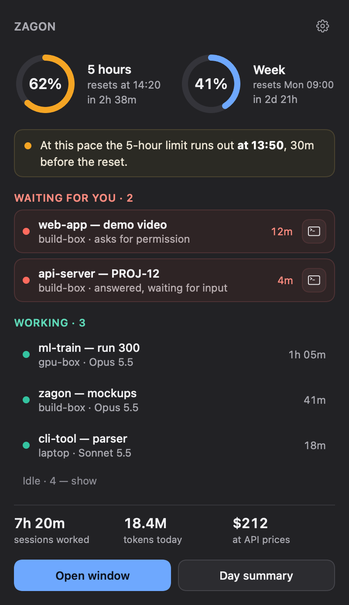
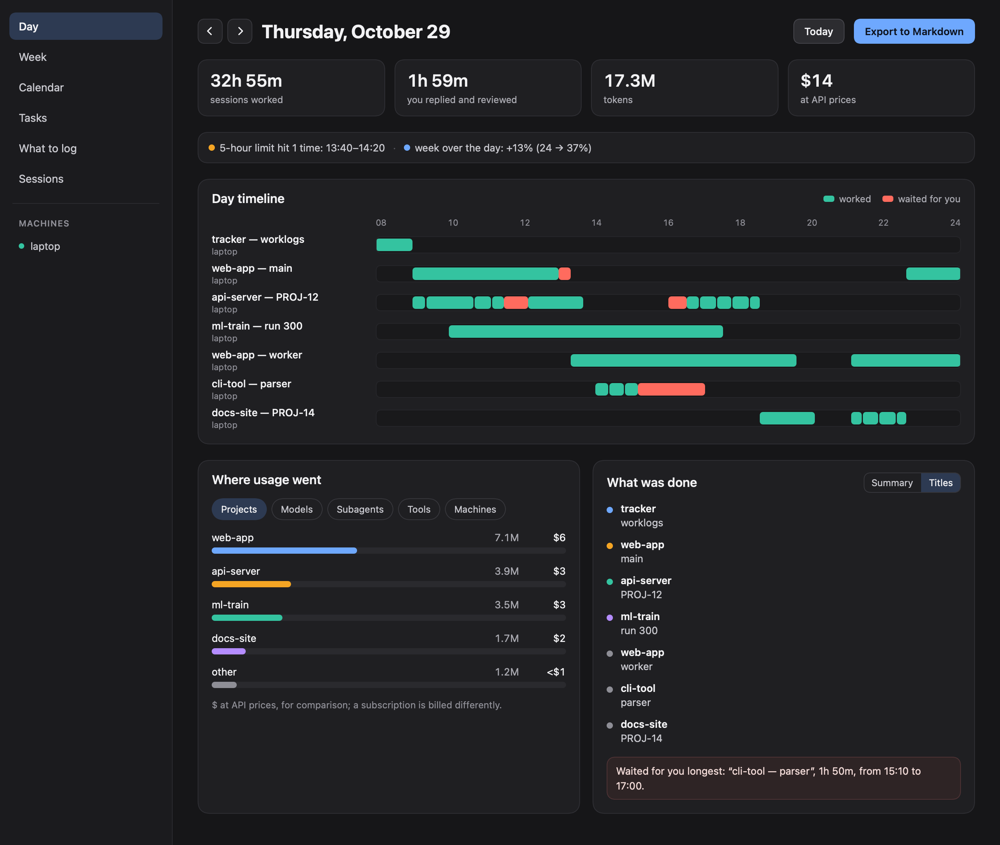
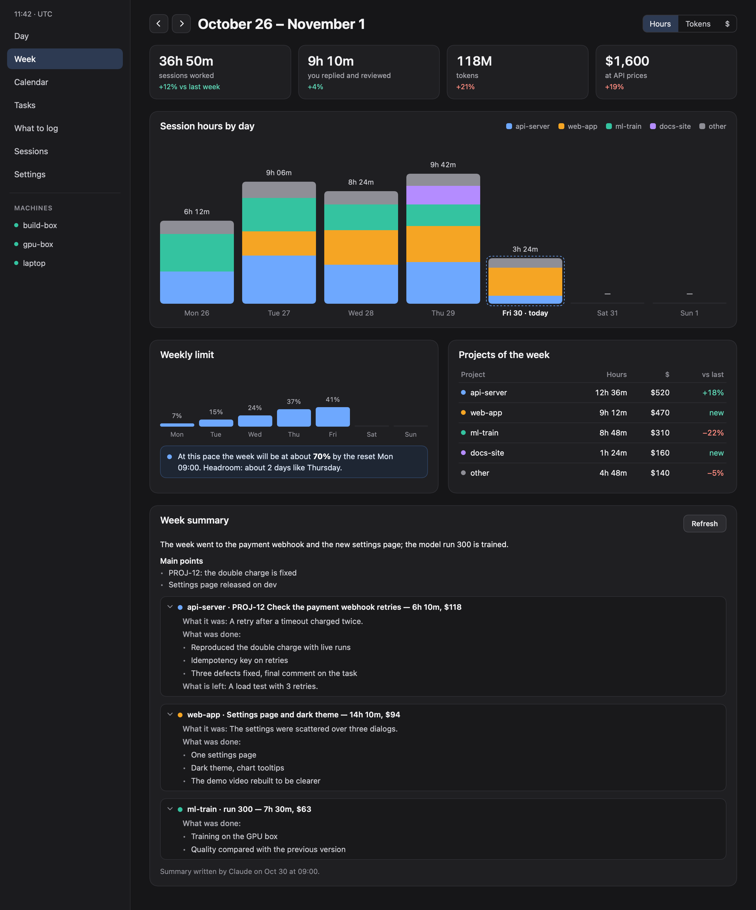
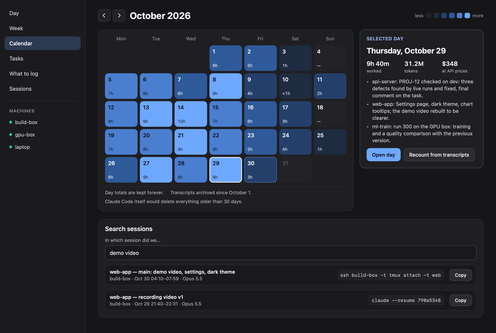

# Zagon

Zagon keeps track of your Claude Code and Codex CLI sessions: subscription limits, which sessions are working or
waiting for you, tokens and time per day and per project, history, summaries, your own task list with worklogs, and
handoff of a session's context to a new session or another AI. Everything is collected and kept on your machine.

There are two versions on one core:

- **Server (Linux)**: a single static binary without dependencies. It runs as a user service, keeps daily totals
  in SQLite, answers in the terminal, and answers Claude and Codex through MCP.
- **macOS app**: a menu bar item and a window. It reads the same data locally and from your servers over SSH.

The macOS app (sample data): the menu bar, then the Day, Week and Calendar windows.

<p align="center"></p>







> **Status: early releases (0.x).** Binaries and the macOS app are on the
> [Releases](https://github.com/a1lezakty/zagon/releases) page. Commands in this README are the ones the latest
> release has.

| Feature | State |
|---|---|
| Claude Code transcripts and Codex sessions: tokens, models, tools, projects, sub-agents | works |
| Session time and your own time per day, live status from hooks (working / waiting for you) | works |
| CLI reports: `today`, `day`, `week`, `sessions` | works |
| Background service (`zagon daemon`), install / uninstall / doctor | works |
| Limits from the Claude Code status line and Codex session files: MCP `limits`, Telegram `/limits`, alerts | works |
| MCP server for Claude Code and Codex (`zagon mcp`): reports and search | works |
| Notifications (Telegram, ntfy) and a Telegram bot | works |
| Daily "what was done" summary (`zagon summary`, sent in the evening) | works |
| Compressed archive of transcripts, kept after Claude Code deletes them (`zagon archive`) | works |
| Context handoff between sessions and tools (`zagon handoff`, MCP `handoff_*`) | works |
| Task list, worklog plan, Jira (`zagon task`, `zagon log`, MCP `task_*`, `worklog_*`) | works |
| macOS app: menu bar, Day / Week / Calendar / Tasks windows, servers over SSH, self-updating | works |
| Release binaries, install script, `zagon update` | works |
| Homebrew | not yet |

## Privacy

- Everything stays local and there is no telemetry. The only network requests are the notifications you configure
  (Telegram Bot API or ntfy, through `curl`), Jira if you connect it, and updates: `zagon update` goes to GitHub only
  when you run it (the service never checks), and the macOS app checks its update feed on GitHub once a day (turn
  that off in Settings → Updates).
- It reads only local files: Claude Code transcripts (`~/.claude/projects`), Codex session files and its thread index
  (`~/.codex/sessions`, `~/.codex/archived_sessions`, `~/.codex/state_*.sqlite`), plus what its own hooks and status
  line wrapper record. To name the project of a working directory it also looks for a `.git` above it (and a
  worktree's `commondir`) and reads the `origin` URL from its git config; it stores the directory paths and project
  names, never file contents or URLs.
- Limits come only from what Claude Code passes to its status line (`rate_limits`, Claude Code 2.1.80+ on Pro and
  Max) and from Codex's own session files. Zagon never reads or stores OAuth tokens, cookies or credential files,
  and it does not call any usage API. So it shows the 5-hour and weekly windows, and the last reading when no
  session is running. The current reading is the highest one of the newest window, from any session or connected
  server: a session left open keeps re-sending its older, lower reading. Readings carry no account, so two accounts
  (say, a personal one on the Mac and a work one on a server) mix and the higher usage is shown. The Mac does not
  yet say which server a reading came from.
- The database does not hold the text of your conversations. It holds numbers, times, project names, git branches
  and session titles: the ones Claude Code generates or you set, and Codex thread names (never your first prompt).
  Hooks record ids, paths, event names and numbers only, never prompts or tool input.
- The archive does keep text: compressed copies of the transcript files, in `~/.zagon/archive`, so your history
  outlives Claude Code's 30-day cleanup. Run the service with `zagon daemon --no-archive` to turn that off.
- The daily summary written by an AI is one call a day on your own subscription: `claude -p --safe-mode` on a cheap
  model (no CLAUDE.md, hooks, plugins or MCP servers of yours), or `codex exec --ephemeral --ignore-user-config`.
  It gets a compact digest: titles, projects, times, edited files, your commit subjects and the first words of the
  day's first typed messages. With `[summary] engine = "none"` the summary is built without AI.
- Your typed messages go into a contentless full-text index used for search: the words can be searched, the text
  itself is not kept. Pass `--no-index-prompts` to `zagon scan` / `zagon daemon` to turn that off.
- Data lives in `~/.zagon` (or `$ZAGON_DIR`): `zagon.db`, `spool/`, `archive/`, `logs/`, `config.toml`, `backup/`.

## Install on a Linux server

```sh
curl -fsSL https://raw.githubusercontent.com/a1lezakty/zagon/main/install.sh | sh -s -- --enable-service
zagon doctor
```

The script downloads the latest `zagon-linux-x86_64` or `zagon-linux-aarch64` from Releases, checks it against
`SHA256SUMS`, puts it in `/usr/local/bin` (as root) or `~/.local/bin`, and runs `zagon install` with the arguments
after `--`. Without `--enable-service` the service unit is written but not started. To do it by hand: download the
binary for your CPU from [Releases](https://github.com/a1lezakty/zagon/releases), then
`install -m 755 zagon-linux-x86_64 ~/.local/bin/zagon && zagon install --enable-service`.

`zagon doctor` lists what is installed, shows the service log, and exits with 1 if something is missing. Then set up
[notifications](#notifications) if you want them.

What `zagon install` changes:

- **`~/.claude/settings.json`**:
  - hooks for `SessionStart`, `UserPromptSubmit`, `PermissionRequest`, `PostToolUse`, `Notification`, `Stop` and
    `SessionEnd`, each running `zagon hook claude <event>`;
  - the status line command becomes `zagon statusline`. Your previous command is saved in `~/.zagon/config.toml`
    (`[statusline] original_command`) and still runs with the same input, so your status line looks the same.
  - Opt out with `--no-claude` or `--no-statusline`.
- **`~/.codex/hooks.json`**, if `~/.codex` exists:
  - hooks for `SessionStart`, `UserPromptSubmit`, `PermissionRequest`, `PostToolUse`, `Stop`, `Interrupt` and
    `SessionEnd`;
  - open `/hooks` in Codex once to trust them;
  - opt out with `--no-codex`.
- **MCP registration** (default `--mcp`): runs `claude mcp add --scope user zagon -- zagon mcp` and
  `codex mcp add zagon -- zagon mcp`. The second one writes `[mcp_servers.zagon]` into `~/.codex/config.toml`.
- **systemd units**:
  - `~/.config/systemd/user/zagon.service`, running `zagon daemon`;
  - `--enable-service` enables and starts it;
  - on a host without a user systemd, run `sudo zagon install --system-service --enable-service`. That writes
    `/etc/systemd/system/zagon-<user>.service` running as you: under sudo, install works for the user who ran sudo
    (or `--user <name>`), writes the files in that user's home as that user, and leaves the MCP registration to a
    plain `zagon install`.
- `--bin <path>` sets the binary that hooks, the status line and the service run (an absolute path to an
  executable; default: the running binary).

Before changing a file, `install` copies it to `~/.zagon/backup/<time>/`. Running `install` again changes nothing
that is already in place. Unknown keys and the formatting of your JSON files are kept.

**Undo**: `zagon uninstall`.

- It removes the hooks, the status line wrapper, the MCP registrations and the systemd units.
- A file you have not touched since install is restored from the backup byte for byte. In a file you changed since,
  only Zagon's entries are removed.
- The database in `~/.zagon` stays. Delete that directory yourself if you want it gone.

### Update

```sh
zagon update --check    # is there a newer release?
zagon update            # replace the binary and restart the service
```

`zagon update` downloads the latest release for your CPU, checks it against `SHA256SUMS`, and only then replaces
its own binary (atomically, in the same directory). The old binary stays next to it as `zagon.prev`: move it back to
roll back (not across a database schema change: the older binary refuses a newer database). Running services are restarted. If the binary is in `/usr/local/bin`, run `sudo zagon update` (behind a
proxy: `sudo -E zagon update`, since sudo drops the proxy variables). On macOS the app updates itself, the `zagon`
inside it included.

The first start of 0.1.0 over an earlier build recounts the whole history once (database schema v5: usage by the
folder of each request, the 1-hour cache split), which takes as long as the very first scan. 0.1.1 moves the database
to schema v6 (which session drives a worker) and rebuilds the days once; after that 0.1.0 no longer opens it, so
update servers and the Mac together and do not roll back to 0.1.0.

## Use

```sh
zagon today                    # tokens and $ at API prices, session time, your time, models, projects, tools, top sessions
zagon day 2026-10-29           # any day
zagon week --end 2026-10-29    # seven days vs the seven before
zagon sessions --limit 10      # recent sessions; --day YYYY-MM-DD for one day
zagon scan                     # read new data once (reports do this anyway unless --no-scan)
zagon summary 2026-10-29       # what was done that day; --engine claude|codex|none, --png ribbon.png, --send
zagon archive stats            # archived sessions, bytes before / after compression
zagon archive cat <session>    # print an archived transcript (id or a unique prefix)
zagon notify test              # a test message to every configured channel
zagon tz Asia/Almaty           # the zone days are cut in (no argument: show it; `system` = the machine's)
zagon daemon --verbose         # what the service runs: follow files, keep totals current, notify, archive
zagon export --since 0         # changed totals as NDJSON, read by the macOS app over SSH
zagon handoff latest --to claude   # a summary of a session to continue it in a new one (claude|codex|gemini|cursor|clipboard|file)
zagon task list                # your tasks with their time; task add|show|todo|note|done|status|link|import|suggest
zagon log plan 2026-10-29      # what to log to Jira that day; log commit writes it (asks first)
zagon update                   # the latest release (see Update above)
```

- Every report takes `--json`.
- `$` is at API list prices, for comparison: a subscription is billed differently. Each model has its own price
  for input, output, cache reads and cache writes (Anthropic: 1.25x input for 5 minutes, 2x for 1 hour; OpenAI: as
  listed, free for most models), from the Anthropic and OpenAI pricing pages. In the CLI and MCP reports a model with
  no known price is shown as `$ ?` (`$12+?` when only part of the tokens has a price), not as $0. Prices that depend
  on a request's length (long prompts) or on fast mode are not applied.
- Tokens and session time count for the project each request and stretch was in. A folder inside a git repository
  counts for the repository: the name in its `origin` URL (`…/zagon.git` → `zagon`), else the main checkout's folder
  name, so worktrees count with their repository. Folders outside git under temporary places (`/tmp`, `$TMPDIR`,
  `/var/folders`, `~/.claude`) count as one project, `(temp)`; any other by its last folder name. Inside the folder a
  session started in (`cd src`), the project of that folder, unless it is your home directory or `/`. On macOS,
  folders that ask for access (Desktop, Documents, Downloads, iCloud Drive, cloud drives, external and network
  volumes) count by folder name, without looking inside. A session is listed under the project of the folder it
  started in.
- "You" is your own messages: one that another session types into a worker's terminal (`tmux send-keys`) is not yours.
- Common options:
  - `--data-dir` (default `$ZAGON_DIR` or `~/.zagon`);
  - `--claude-dir` (default `~/.claude/projects`);
  - `--codex-dir` (default `$CODEX_HOME` or `~/.codex`);
  - `--idle-gap` minutes: your actions closer than this count as one stretch of work (default 20);
  - `--session-gap` minutes: agent silence that ends a working interval (default 30).

### Your time

"Your time" is built from the messages you type and the ends of the answers you replied to, chained while the gaps
stay under `--idle-gap`. A message that one session types into another (an agent driving worker sessions with
`tmux send-keys`) is not yours: Zagon sees the driver's `tmux send-keys` / `send` / `paste-buffer` call in its Claude
Code transcript and takes a message typed in another session from 5 s before to 30 s after it as relayed. Limits:

- if you type into an unnamed session (or one named like the target) in that window around another session's
  send-keys to a pane that names no other session, your message is taken for a relay;
- a driver that types some other way (a script that hides `tmux` from the command, `screen`, `ssh` to another host)
  or sleeps longer than 30 s before the message is not seen, so its messages count as yours.

Name worker sessions like their tmux targets (`claude --name`): then only send-keys aimed at that name count for them.

## MCP

`zagon mcp` serves the Zagon data to Claude Code, Codex and other MCP clients over stdio. Register it with:

```sh
claude mcp add --scope user zagon -- zagon mcp
codex mcp add zagon -- zagon mcp
```

`zagon install` does the same.

Tools: `limits`, `sessions`, `day`, `week`, `range`, `search`, `export_day`, `settings_timezone`. Answers are short
and carry numbers; a long one, such as a day exported to Markdown, goes to a file in `~/.zagon/exports`.

- handoff: `handoff_create`, `handoff_get`, `handoff_list`, and the prompt `/mcp__zagon__resume <id|latest>`;
- tasks: `task_list`, `task_get`, `task_create`, `task_update`, `task_suggestions`, `task_suggestions_answer`;
- worklogs: `worklog_plan`, `worklog_commit` (needs `confirm: true` and is meant only for an explicit request).

## Notifications

The service sends alerts through your own Telegram bot or an [ntfy](https://ntfy.sh) topic:
- a limit at 80 % and 95 % (5-hour and weekly, Claude and Codex), and a limit reset;
- a session waiting for you longer than 10 minutes (unless "finished" was already sent for that stop); a worker that
  another session drives over `tmux send-keys` waits for that session, not for you, so it is shown as "waits for
  session …" and sends no such alert; a leader killed without `SessionEnd` releases its workers after 12 hours;
- a turn that worked longer than 15 minutes has finished, and its sub-agents and background commands too (not for
  a worker another session drives: that session watches it);
- the day summary at 20:00, with a picture of the day.

Nothing is sent during quiet hours (23:00–08:00). Keep notifications on one host only. Every key in
`~/.zagon/config.toml` is optional; the main ones with their defaults:

```toml
timezone = ""               # e.g. "Europe/Berlin"; empty = system zone. Days are cut at this zone's midnight.
                            # Also `zagon tz <zone>`, Telegram `/tz <zone>`, MCP `settings_timezone`.

[notify]
enabled = true              # this host sends notifications
limit_reset = true
waiting_minutes = 10        # 0 = off
long_work_minutes = 15      # 0 = off
summary_at = "20:00"        # "" = off
quiet = "23:00-08:00"       # "" = off
lang = "auto"               # auto | ru | en: notifications, bot replies, day summary; auto = the system language

[notify.limits]             # thresholds, 50...100 in steps of 5; [] = off
claude.five_hour = [80, 95]
claude.week = [80, 95]
codex.five_hour = [80, 95]
codex.week = [80, 95]

[telegram]
token_file = "~/.config/zagon/tg-bot-token"   # your bot's token from @BotFather, in a file only you can read
chat_id = "123456789"       # the only chat the bot writes to and answers
commands = true             # answer /limits /sessions /today /week /day /tz (one host per bot)

[ntfy]
topic = ""                  # set a topic to turn ntfy on
url = "https://ntfy.sh"

[summary]
engine = "claude"           # claude | codex | none
model = "haiku"
timeout = 120               # seconds; on failure the summary is built without AI
```

Check with `zagon notify test`. The service reads the file when it starts, so restart it after a change.

## macOS app

Download `Zagon.dmg` from [Releases](https://github.com/a1lezakty/zagon/releases/latest). The app has an ad-hoc
signature, because there is no paid Apple developer account, so macOS blocks it on first launch:

1. Open the DMG and drag Zagon to Applications. Run it from there: an app started from the DMG or from Downloads
   cannot update itself.
2. Open it once. macOS says it cannot verify the developer.
3. Go to System Settings → Privacy & Security and click **Open Anyway** next to the Zagon message. On macOS 15 and
   later, right-click → Open no longer bypasses this.

On first launch macOS may ask whether Zagon can access your Documents or Desktop folder: it asks when your Claude
Code or Codex projects live there (Zagon reads their `.git` to tell which checkout a session belongs to), and the
Desktop also when you save diagnostics there.

It needs macOS 13 or later. It offers servers from `~/.ssh/config`; each server needs the Linux version installed.
After that the app updates itself: it checks GitHub for a new release once a day and asks before installing (the
update is signed). Turn the check off, or check now, in Settings → Updates. Because the signature is ad-hoc, macOS may
ask again for permissions tied to it (such as access to a folder) after an update.

## Build from source

You need Swift 6.4.1. On Linux the `swift:6.4.1-bookworm` Docker image works, so nothing goes on the host. On macOS
you need macOS 13 or later.

```sh
swift build -c release            # .build/release/zagon
swift test
```

Static Linux binary, with the Static Linux SDK 6.4.1:

```sh
swift sdk install https://download.swift.org/swift-6.4.1-release/static-sdk/swift-6.4.1-RELEASE/swift-6.4.1-RELEASE_static-linux-0.1.0.artifactbundle.tar.gz \
  --checksum cef5592d7430ed3c5ae1ddda479849c6f5252bd94a5723db1559f984caf38a7c
swift build -c release --swift-sdk x86_64-swift-linux-musl -Xlinker -s   # or aarch64-swift-linux-musl
```

`scripts/dev.sh build|test|build-static` runs the same steps in a Docker container. CI (`.github/workflows/core.yml`)
does the following on every push:
- builds and tests;
- builds static x86_64 and aarch64 binaries and fails if one is over 20 MB;
- runs a smoke scan over the anonymized test fixtures.

Releases come from a `v*` tag through `.github/workflows/release.yml`; see [docs/RELEASING.md](docs/RELEASING.md).

Contracts between packages are in `docs/dev/contracts.md`.

## License

MIT, see [LICENSE](LICENSE).
